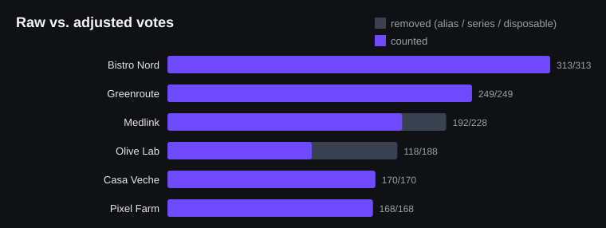

# vote-guard

**Public online voting that holds up when people try to game it: rules enforced by the database, network rate limiting that can't be spoofed, and an audit that finds fake accounts.**

<p align="center"></p>

Extracted from the public vote of a regional business awards (22,765 votes, 136 nominees across dozens of categories, with Google sign-in). Whenever there's a prize, someone shows up with seventy accounts. This repo is the part that dealt with that, rebuilt as a reusable kit.

## Three layers

### 1. The database is the referee (`sql/schema.sql`)
Nothing important is left to the UI:
- **One vote per account per category** is a unique constraint. Double clicks and replayed requests just fail.
- **The deadline** is an RLS policy that compares `now()` (the database clock) with `vote_settings.voting_closes_at` on every insert. A countdown in the browser is cosmetic.
- **The category must match the nominee's**, so a vote can't be filed under the wrong category to dodge the constraint.
- **Counters** are bumped by a trigger; clients have no `UPDATE` policy on nominees.
- **The voter's email** is filled from the JWT by a column default, so the client never sends it.
- **The rate-limit log** has RLS on and zero policies: only the server function can touch it.

### 2. Network rate limiting (`src/ip-guard.ts`, `functions/check-vote`)
A Supabase Edge Function called before the insert: at most N votes per network per window (45 per 10 minutes by default, sized so a whole office can vote in every category). Two deliberate choices:
- **The client IP comes from the right end of `X-Forwarded-For`**, the hop your own proxy appended. The left-most value is written by the client: trusting it lets a voter get a fresh bucket on every request. A test proves that spoofing it no longer resets the limit.
- **IPs are never stored**, only a keyed HMAC. With no secret configured it **fails closed** instead of falling back to a built-in salt, which would make every hash brute-forceable over the IPv4 space.

### 3. The audit (`analysis/fraud_report.py`)
Run it on an export after (or during) the vote. Every signal is simple enough to explain to a jury:

| signal | rule |
|---|---|
| `alias_mailbox` | accounts that land in one inbox: Gmail ignores dots and `+tags`, and `googlemail.com` = `gmail.com`. Only the first vote per inbox and category counts |
| `account_series` | 5+ accounts on one name stem whose numeric suffixes cluster (`ion1`, `ion2`, `ion3`…). Namesakes with scattered numbers (`maria.stan12`, `maria.stan451`) are left alone |
| `disposable` | throwaway e-mail domains |
| `burst` | every 10-minute window where a nominee gets far more votes than its usual pace |

It writes `report.md` (raw vs. adjusted votes per nominee, suspicious share, peak window), `report.json` and the chart above. Nothing is deleted: organisers decide.

**`--anonymise`** exports the same rows with no personal data: user, email, inbox and name-stem become keyed BLAKE2 hashes with a fresh random key per export. Hashes can't be reversed or joined across exports, but within one file the same inbox still has the same hash, so the analysis can be shared.

On the bundled synthetic vote (1,316 votes, with three attacks injected) it flags **all 106 fraudulent votes and 0 of the organic ones**: [docs/report.md](docs/report.md).

## Run

```bash
# database: run sql/schema.sql in the Supabase SQL editor, then
insert into vote_settings (voting_closes_at) values ('2026-09-23 23:59:59+03');

# edge function
supabase secrets set VOTE_IP_SECRET=$(openssl rand -hex 32)
supabase functions deploy check-vote

# audit
python analysis/synthetic.py demo.csv
python analysis/fraud_report.py demo.csv --out report --anonymise demo-anon.csv
```

## Tests

```bash
node --test "tests/*.test.ts"      # 5 tests: IP extraction, spoofing, HMAC fail-closed, window throttling
python -m pytest -q analysis       # 6 tests: Gmail rules, series vs. namesakes, bursts, synthetic attacks, anonymisation
```

## License

MIT
